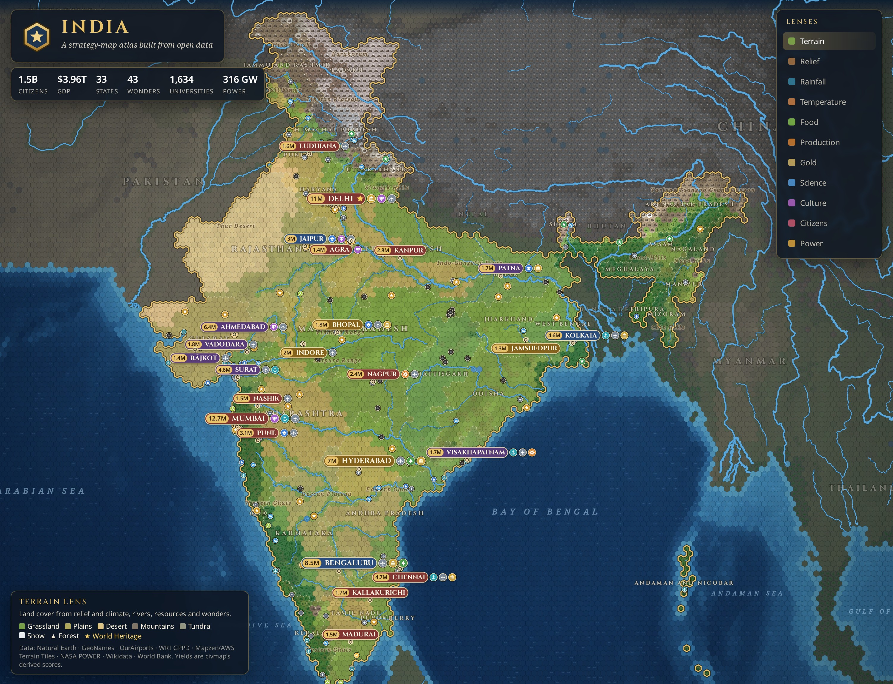
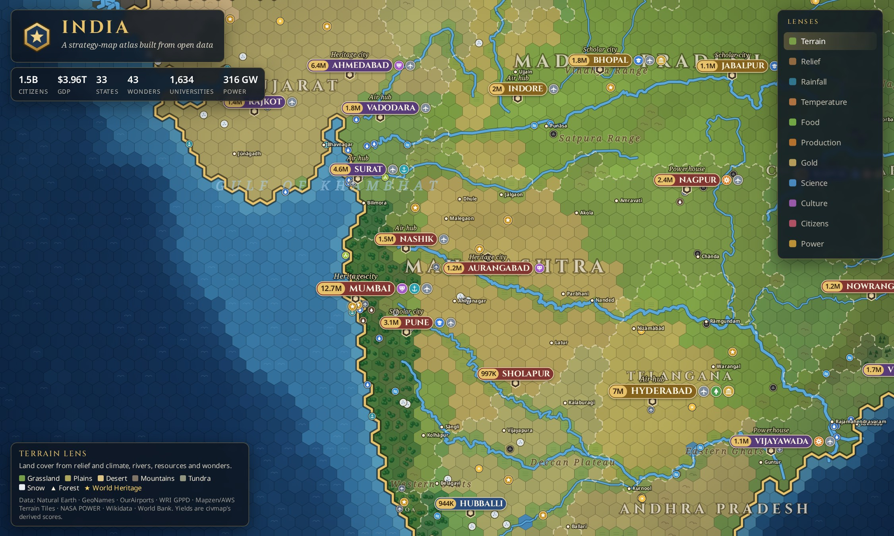
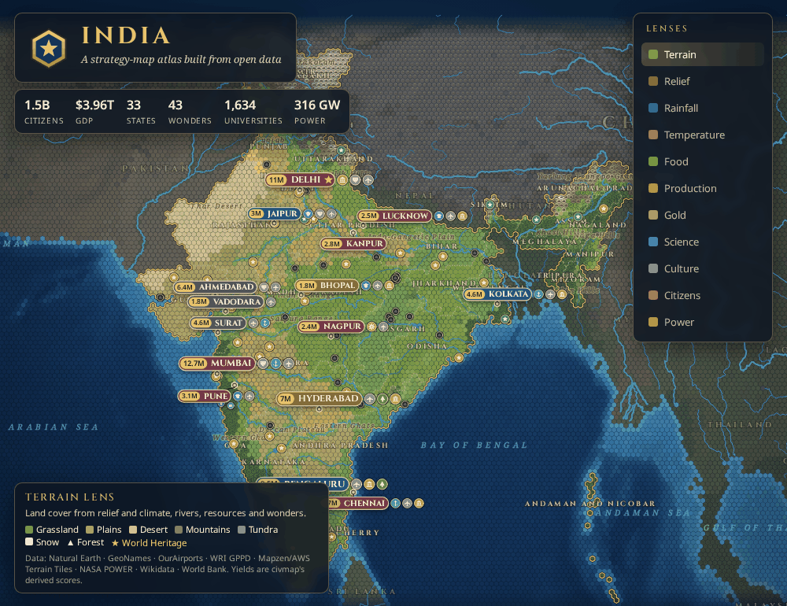
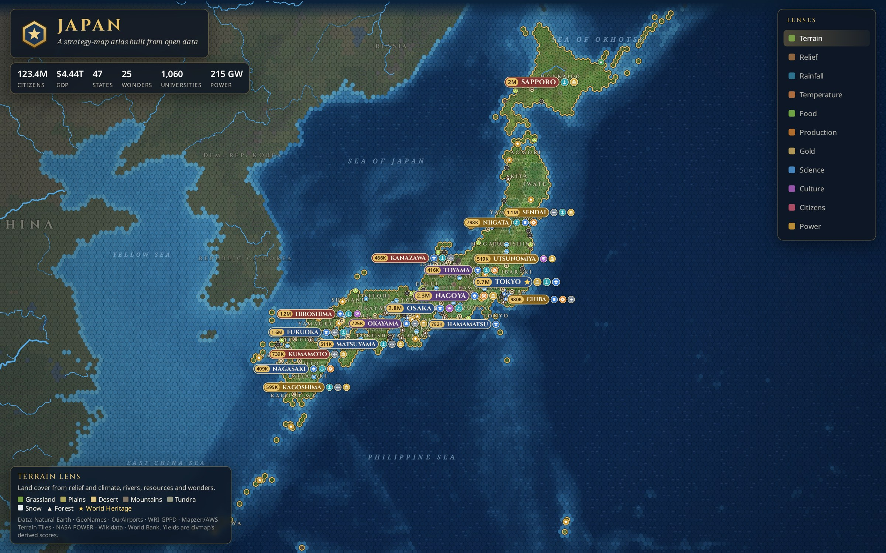
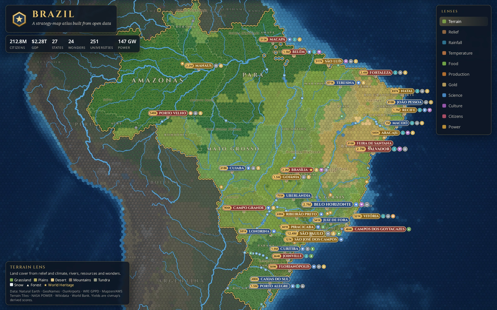
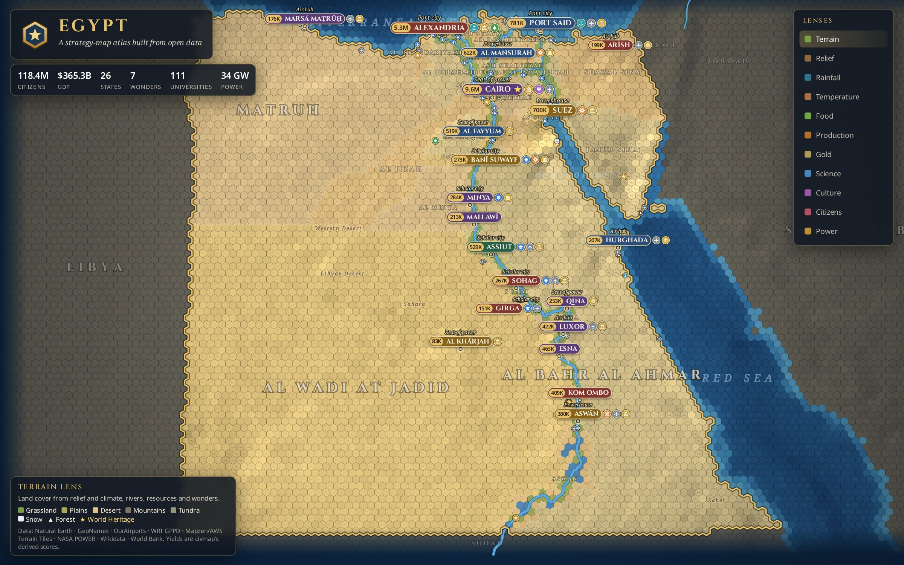
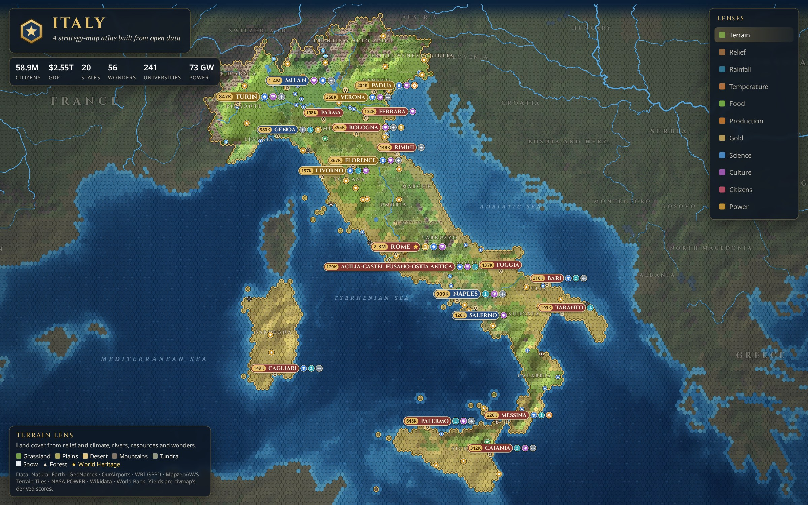
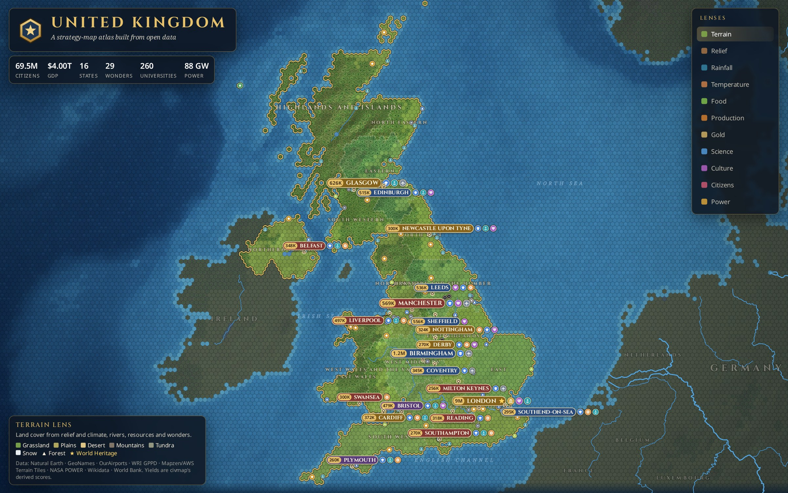
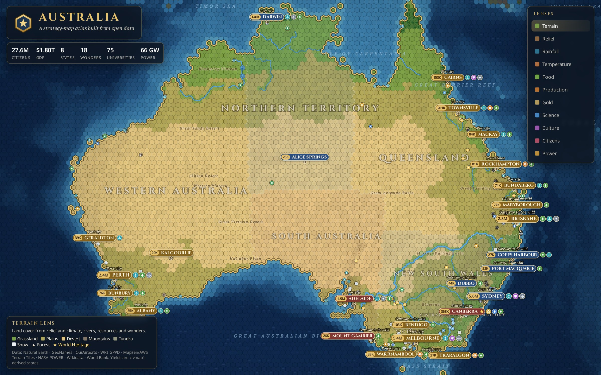

<p align="center">
  <a href="https://jatingargiitk.github.io/civmap/"></a>
</p>

<h1 align="center">civmap</h1>

<p align="center"><b>Turn any country into a Civilization-style strategy map, built only from open data.</b><br>
<code>civmap IN</code> gives you hex terrain, rivers, states, city banners with districts, World Heritage wonders, resources and 11 lenses, all in one HTML file.</p>

<p align="center">
  <a href="https://jatingargiitk.github.io/civmap/"><b>▶ Live demo</b></a> ·
  <a href="https://jatingargiitk.github.io/civmap/#IN">India</a> ·
  <a href="https://jatingargiitk.github.io/civmap/#JP">Japan</a> ·
  <a href="https://jatingargiitk.github.io/civmap/#BR">Brazil</a> ·
  <a href="https://jatingargiitk.github.io/civmap/#EG">Egypt</a> ·
  <a href="https://jatingargiitk.github.io/civmap/#IT">Italy</a> ·
  <a href="https://jatingargiitk.github.io/civmap/#GB">UK</a> ·
  <a href="https://jatingargiitk.github.io/civmap/#FR">France</a> ·
  <a href="https://jatingargiitk.github.io/civmap/#AU">Australia</a>
</p>

<p align="center"><a href="https://github.com/jatingargiitk/civmap/actions/workflows/ci.yml"></a> </p>

Inspired by Andrej Karpathy's [usaciv](https://karpathy.ai/usaciv/) ([post](https://x.com/karpathy/status/2125779541952246039)), which turned the United States into a Civ map. civmap is a separate, from-scratch implementation that works for **any country**, with India first.

## Quickstart

```bash
pip install "git+https://github.com/jatingargiitk/civmap"
civmap IN                      # writes india.html: open it in a browser
civmap Japan --png             # also saves japan.png (needs: pip install playwright && playwright install chromium)
civmap "United Kingdom" --hexes 8000 --png uk.png --lens rain
```

Countries can be given as an ISO code (`IN`, `IND`) or a name (`India`). The first run downloads roughly 130 MB of open data into `~/.cache/civmap`, and each further country adds about 15–30 MB. After that a country builds in seconds, and you can run offline with `CIVMAP_OFFLINE=1`.

The HTML file is self-contained: one `<canvas>`, no frameworks and no server. Drag to pan, scroll to zoom, hover a hex for its numbers and click a city for its districts. Press `f` to refit the view.

## What's on the map

<p align="center"></p>

| Map element | How civmap derives it |
|---|---|
| **Hex grid** | Equal-area (Lambert azimuthal) projection centred on the country, so every hex covers the same real area. By default it uses about 5,000 land hexes; India's are about 655 km² each. |
| **Terrain** | Each hex samples elevation at 7 points (mean and relief) and gets annual rainfall and temperature from NASA POWER, corrected to the hex's height. Simple published rules then turn these into Grassland, Plains, Desert, Tundra, Snow or Mountains, with Hills, Forest, Jungle and Floodplains on top ([`terrain.py`](civmap/terrain.py)). |
| **Rivers, lakes, seas** | Natural Earth rivers and lakes. Sea depth comes from the same elevation tiles. |
| **Borders** | The national border is drawn gold; states and provinces are dashed. Where a country has a Natural Earth *point-of-view* edition, civmap uses it, so India is drawn the way India draws itself. Neighbouring countries appear under fog of war. |
| **Cities** | The largest GeoNames places, shown as banners with population, a capital star and up to three district badges. Click a city to see the reasons. |
| **Districts** | A city gets a district when something is **concentrated** near it, measured as a location quotient against its share of national population:<br>• Campus: universities<br>• Industrial Zone: power-plant MW<br>• Harbor: seaport<br>• Aerodrome: large airport<br>• Theater Square: World Heritage site<br>• Preserve: national park<br>• Government Plaza: capital<br>Every district records its reason, e.g. Nagpur's *"7,052 MW of power plants within 35 km (largest: KORADI, 2,400 MW coal)"*. |
| **Wonders** | UNESCO World Heritage properties, one per inscribed property, from Wikidata. Gold for cultural sites, green for natural ones. |
| **Resources** | The largest power plants by fuel (coal, gas, oil, uranium, hydro, solar, wind), plus large airports and seaports. |

### Lenses

<p align="center"></p>

Terrain · Relief · Rainfall · Temperature · Food · Production · Gold · Science · Culture · Citizens · Power.

The yields are **civmap's own derived scores**, made in the spirit of Civ VI. **Gold is a trade proxy (airports, seaports, city size), not GDP.** Every lens names its source in the legend.

## Gallery

Each image below is a real `civmap` run, screenshotted with headless Chromium by [`scripts/build_gallery.py`](scripts/build_gallery.py).

| | |
|---|---|
|  **Japan** |  **Brazil** |
|  **Egypt**: the Nile valley in a sea of desert |  **Italy** |
|  **United Kingdom** |  **Australia** |

## Data sources and licenses

civmap downloads everything at build time from these providers. The rendered maps in `docs/data` are derived from them and keep their licenses and attribution.

| Data | Used for | License |
|---|---|---|
| [Natural Earth](https://www.naturalearthdata.com/) 1:10m: countries (including point-of-view editions), admin-1 states, rivers, lakes, ports, geographic and marine regions | outline, states, rivers, lakes, seaports, region and sea labels | Public domain |
| [GeoNames](https://www.geonames.org/) `cities15000` | cities, population | [CC BY 4.0](https://creativecommons.org/licenses/by/4.0/) |
| [OurAirports](https://ourairports.com/data/) | airports (Aerodrome, Gold) | Public domain |
| [WRI Global Power Plant Database](https://datasets.wri.org/dataset/globalpowerplantdatabase) v1.3 | power plants (Industrial Zone, Production, resources) | [CC BY 4.0](https://creativecommons.org/licenses/by/4.0/). Global Energy Observatory, Google, KTH Royal Institute of Technology, Enipedia, World Resources Institute |
| [Mapzen / AWS Terrain Tiles](https://registry.opendata.aws/terrain-tiles/) (Terrarium) | elevation, relief, sea depth | Mixed open sources, [attribution](https://github.com/tilezen/joerd/blob/master/docs/attribution.md): SRTM, GMTED2010, ETOPO1, NED and others |
| [NASA POWER](https://power.larc.nasa.gov/) climatology (`PRECTOTCORR`, `T2M`) | rainfall, temperature, so terrain | Public. *"These data were obtained from the NASA Langley Research Center (LaRC) POWER Project funded through the NASA Earth Science/Applied Science Program."* |
| [Wikidata](https://www.wikidata.org/) | World Heritage sites, universities, national parks, population cross-checks | [CC0](https://creativecommons.org/publicdomain/zero/1.0/) |
| [World Bank Open Data](https://data.worldbank.org/) (`SP.POP.TOTL`, `NY.GDP.MKTP.CD`) | population and GDP on the empire bar | [CC BY 4.0](https://datacatalog.worldbank.org/public-licenses) |

That makes 19 layers from 8 providers. For comparison, Karpathy's US map reconciles 31 US-specific sources; civmap trades that depth for sources that cover every country.

## Honest caveats

- **Yields are derived, not measured.** Food, Production, Gold, Science and Culture are transparent scores from the data above. Read [`terrain.py`](civmap/terrain.py) and [`districts.py`](civmap/districts.py) and argue with the rules.
- **Population is GeoNames "city proper".** A few GeoNames entries carry district-sized figures. civmap cross-checks the 150 largest places against Wikidata (by GeoNames id) and keeps the smaller figure when the two disagree by more than 2x. Entries Wikidata can't match are kept as they are (in India, for example, Kallakurichi still shows 1.7M).
- **Coverage follows the data.** Wikidata coverage of universities and parks varies by country. The WRI database was last updated in 2021.
- **Borders** come from Natural Earth and are not an endorsement of any claim.
- Very large or spread-out countries get bigger hexes: the whole frame is capped at about 34,000 hexes so it stays smooth in a browser. Remote overseas territories are dropped.

## How it works

```
civmap/sources.py    download + cache every dataset (no API keys)
civmap/geo.py        equal-area projection, axial hex grid
civmap/terrain.py    elevation + climate -> terrain, features, base yields
civmap/districts.py  location-quotient districts with human-readable reasons
civmap/build.py      assemble hexes, states, borders, rivers, cities, wonders -> JSON
civmap/viewer/       dependency-free canvas viewer (lenses, tooltips, city cards)
civmap/render.py     inline everything into one HTML file; optional PNG via Playwright
```

## Development

```bash
pip install -e ".[test]"
CIVMAP_OFFLINE=1 pytest -q              # offline suite with a synthetic country
python scripts/build_gallery.py --images  # rebuild docs/ (the GitHub Pages demo)
python scripts/render_readme_images.py  # rebuild the README images
```

## Credits

- The idea and the "real economy as a Civ map" framing come from **[Andrej Karpathy's usaciv](https://karpathy.ai/usaciv/)**. civmap shares no code with it.
- Thanks to every open-data project listed above.
- *Civilization* is a trademark of Take-Two Interactive. civmap is an unaffiliated fan-style visualisation.

## License

[MIT](LICENSE) © 2026 Jatin Garg. The data keeps its own licenses (see above).
